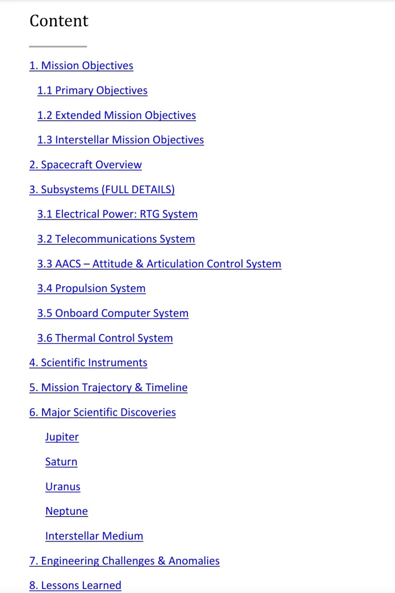

# Voyager 2 Deep-Space Mission Analysis

Technical mission analysis of NASA's Voyager 2, carried out as a team project for a Space Mission Analysis and Design course. Launched in 1977, Voyager 2 is still communicating from deep space - the analysis looks at the engineering that makes that possible.

## What it covers

- Mission architecture and objectives across the Jupiter, Saturn, Uranus and Neptune flybys.
- Gravity-assist trajectory design (the Grand Tour) and its role in energy and mission feasibility.
- Mission requirements: long-term power from RTGs, attitude control via AACS, Deep Space Network (DSN) communication, thermal control and system reliability.
- Scientific payload and data collection during extended deep-space operations.

The project highlighted the importance of requirements-driven design and system-level trade-offs in long-duration deep-space missions.

## Role

Team member (five-person team) contributing to the mission requirements, trajectory design and spacecraft subsystems analysis.

## Tools & methods

- Mission analysis and design methods (orbital mechanics, astrodynamics, requirements-driven design)
- Public NASA mission data

## Links

- Project post: https://www.linkedin.com/posts/aya-mubarak-829862298_voyager2-spacemissiondesign-missionanalysis-activity-7417280597624127489-a0sR
- Full analysis report: https://lnkd.in/dShk77XQ

## Status

README and project image first; the analysis report is linked above.
